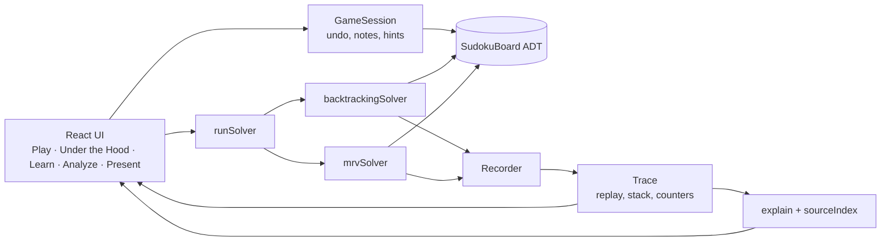
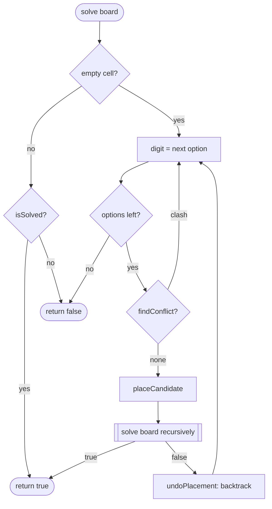

# Sudoku: Under the Hood

**Play the puzzle. Discover the algorithm.**

An interactive Data Structures and Algorithms (DSA) lab built around a real Sudoku game. Students attempt a puzzle first, then watch a recursive backtracking solver work on the same board: every rule check, every recursive call and every backtrack is recorded during a real run, explained in plain language, and linked to the exact line of source code that produced it.

> I came here to play Sudoku, but now I understand how an Abstract Data Type, recursion and backtracking work together to solve a problem.

---

## Contents

1. [Objectives](#objectives)
2. [Problem statement](#problem-statement)
3. [Running the project](#running-the-project)
4. [What the application does](#what-the-application-does)
5. [System architecture](#system-architecture)
6. [The board ADT](#the-board-adt)
7. [The data structure](#the-data-structure)
8. [The solvers](#the-solvers)
9. [Execution trace and replay](#execution-trace-and-replay)
10. [Complexity analysis](#complexity-analysis)
11. [Testing](#testing)
12. [Classroom demonstration guide](#classroom-demonstration-guide)
13. [Scope and limitations](#scope-and-limitations)
14. [Future improvements](#future-improvements)

---

## Objectives

By the end of a session, a student should be able to explain:

- how a Sudoku board can be specified as an **Abstract Data Type** (operations and their promises);
- how a **two-dimensional array** stores that board, and how row-major indexing works;
- how **encapsulation** separates the private representation from the public operations;
- how the solver **checks constraints** (row, column, 3×3 box);
- how **recursion** breaks the puzzle into a smaller copy of itself;
- how **backtracking** undoes a failed choice and restores the board exactly;
- how to **measure** algorithmic work, and how that relates to **Big-O** bounds;
- how a heuristic (**Minimum Remaining Values**) changes the search without changing its worst case.

## Problem statement

DSA concepts are usually introduced top-down: definitions first, code second, intuition last. Recursion and backtracking in particular are hard to *see*: the call stack is invisible, and the moment a branch fails and is undone happens in a few microseconds.

This project turns that around. Students meet the problem as a game, form their own strategy, and only then see how a computer solves it. The algorithm's execution is made visible and reversible, and every visual element is tied to a real operation in real code, so nothing on screen is an illustration that the program does not actually do.

## Running the project

Requirements: **Node.js 20 or newer**.

```bash
npm install
npm run dev          # development server with live reload → http://localhost:5173
npm run build        # production build → dist/index.html (one self-contained file)
npm test             # 99 unit tests (domain, solvers, trace, explanations, lessons, game, timing)
npm run test:e2e     # 24 browser tests with Playwright (builds first)
npm run cpp          # build and test the C++ reference implementation (needs g++ or clang++)
```

The first browser test run may need `npx playwright install chromium`.

`dist/index.html` is a single file with everything inlined. It opens directly from disk (no server needed) and makes no network requests, which makes it convenient for a classroom computer. The two typefaces, Archivo and JetBrains Mono (SIL Open Font License), are bundled in `src/assets/fonts/` as Latin-subset variable WOFF2 files and inlined by the build; `scripts/subset-fonts.py` rebuilds them from the upstream Google Fonts sources.

### Deploy to GitHub Pages

The included GitHub Actions workflow builds the site and deploys `dist/` to GitHub Pages whenever a commit is pushed to `main`. In the repository, open **Settings → Pages** and set **Build and deployment → Source** to **GitHub Actions**. Push to `main` (or manually run **Deploy to GitHub Pages** from the Actions tab); the published URL will appear in the workflow run and in the Pages settings.

**Tooling note.** The specification suggested Vite. The project was built in an environment without access to the npm registry, so it uses **esbuild** directly (the bundler Vite itself uses for development) through two short scripts, `scripts/dev.mjs` and `scripts/build.mjs`, and Node's built-in test runner instead of Vitest. Moving to Vite later only requires a `vite.config.ts` with a `?raw` import (Vite supports it natively) and CSS Modules, which are already used.

## What the application does

| Mode | Purpose |
|---|---|
| **Home / Challenge** | Title, a playable board, and a *Start Challenge* button. No sign-in, nothing to read first. |
| **Play** | A complete Sudoku game: keyboard, mouse and touch input; pencil notes; undo/redo; rule-conflict highlighting; per-digit conflict hints on the keypad; *Check* against the solution; *Hint* that explains its reasoning (naked single, hidden single); reset; puzzle picker with difficulty labels; custom puzzle import with validation. |
| **Under the Hood** | The guided solver. The selected solver really runs on the puzzle and records every operation. Replay it forwards and backwards, at 1–5,000 steps per second, jump to the next backtrack, pause automatically at backtracks. The playback controls sit directly under the board; on screens narrower than 768 px the board comes first and a sticky bar (previous, play, next, step count) stays at the bottom of the screen. Synchronised views: board, explanation (concise or detailed), highlighted source code, call stack with branches, trace log, search-depth timeline, row-major memory strip and live counters. |
| **Learn** | Ten lessons (ADT, ADT vs data structure, encapsulation, 2D arrays, constraints, recursion, backtracking, constraint solving, complexity, optimisation). Each has a definition, a Sudoku example, a live demonstration that calls the real board code, the actual source it refers to, and a knowledge check. Content lives in `src/data/lessons.json`. |
| **Analyze** | Runs plain backtracking and MRV on the same puzzle with tracing off. Each solver gets one uncounted warm-up run, then repeated timed runs; the page reports counters, median time and range. Ratios that would divide by zero (MRV rejects no digits, for example) show n/a with a tooltip explaining why. A batch mode measures every bundled puzzle. Theory is shown in a separate, clearly labelled table. |
| **Present** | Projector layout that always opens on a fresh copy of the classroom demo board (separate from Play-mode progress): large board, large explanation text, the current line of code, one-click Play/Solve switch, reset to the demo puzzle, full screen, and an optional presenter guide whose steps can set up the right moment in the trace. |

Difficulty labels are not guesses. `src/domain/difficulty.ts` solves each puzzle the way a person would and records the hardest technique it needed: **easy** (naked singles only), **medium** (hidden singles), **hard** (candidate eliminations such as pointing pairs and naked pairs), **expert** (those techniques get stuck; trial and error is needed). A test re-rates every bundled puzzle.

## System architecture

```
src/
  domain/                 Pure TypeScript, no UI
    SudokuBoard.ts          The board ADT (private 2D array, documented operations)
    puzzleFormat.ts         Text ⇄ grid conversion with error messages
    solutionCounter.ts      Independent bitmask solver used to check uniqueness
    difficulty.ts           Human-technique difficulty rater
  solver/                 Pure TypeScript, no UI
    backtrackingSolver.ts   Plain recursive backtracking (the code shown in the app)
    mrvSolver.ts            Backtracking with Minimum Remaining Values
    recorder.ts             Emits trace events and keeps work counters
    trace.ts                Replays a recorded run in both directions
    runSolver.ts            Validates input, runs a solver on a copy, reports results
    types.ts                Event and counter types
  explain/
    explain.ts              Turns an event into teaching text (wording in data/explanations.json)
    sourceIndex.ts          Maps step ids to source lines; extracts ADT methods
    sources.ts              Bundles the exact source text of the files above
    highlight.ts            Small TypeScript syntax highlighter
  features/
    play/                   GameSession (pure rules: undo, notes, check, hint) + Play UI
    board/                  SudokuGrid component, puzzle picker
    guided/                 Under the Hood: playback, panels, board view model
    learn/                  Lesson viewer, quizzes, ten live demos
    analyze/                Measurement and comparison
    present/                Classroom presentation mode
    home/                   Landing page
  app/                      App shell, hash routing, shared state
  components/               Buttons, panels, segmented controls, messages
  data/                     puzzles.json, lessons.json, explanations.json, presenterGuide.json
tests/
  unit/                     node:test suites for every layer below the UI
  e2e/                      Playwright tests against the built app
reference/cpp/              C++17 reference implementation of the ADT and both solvers
scripts/                    Build, dev server, puzzle generator
```

**Dependency direction.** UI → features → explain → solver → domain. Nothing in `domain/` or `solver/` imports React. The UI never reads or writes the board's array: the board keeps it in a JavaScript private field (`#grid`), which the engine itself makes unreachable from outside the class.



## The board ADT

An ADT is defined by its operations and their behaviour. The implementation (`src/domain/SudokuBoard.ts`) documents each one in place; this is the summary.

| Operation | Behaviour | Errors |
|---|---|---|
| `initialize(puzzle)` | Loads a 9×9 grid. Non-zero values become immutable clues. Keeps a copy for `reset()`. | `MALFORMED` |
| `getCell(row, col)` | Value at a cell; 0 when empty. | `INDEX_OUT_OF_RANGE` |
| `isGiven(row, col)` | True for a starting clue. | `INDEX_OUT_OF_RANGE` |
| `setCell(row, col, value)` | **Player** write of 0–9 into a non-clue cell. Allows rule conflicts (players make mistakes); returns the old value. | `GIVEN_CELL`, `VALUE_OUT_OF_RANGE` |
| `findEmptyCell()` | First empty cell in row-major order, or `null`. | |
| `findConflict(row, col, digit)` | First clash with the row, column or box, with its location, or `null`. Ignores the cell itself. | `VALUE_OUT_OF_RANGE` |
| `isValid(row, col, digit)` | `findConflict(...) === null`. | |
| `getCandidates(row, col)` | Digits that fit an empty cell; `[]` for a filled cell. | |
| `isComplete()` | No empty cells. Says nothing about correctness. | |
| `isSolved()` | Complete **and** every row, column and box holds 1–9 exactly once. | |
| `findAllConflicts()` | Every pair of cells that currently break a rule. | |
| `validatePuzzle()` | Checks the starting clues only. | |
| `reset()` | Restores the starting puzzle. | |
| `getSnapshot()` / `getOriginal()` | Frozen copies; changing them cannot change the board. | |
| `placeCandidate(row, col, digit)` | **Solver** write: only into an empty, non-clue cell, only a legal digit. Pushes the cell onto a trail. | `GIVEN_CELL`, `CELL_OCCUPIED`, `ILLEGAL_PLACEMENT` |
| `undoPlacement(row, col)` | **Solver** undo of the most recent placement only (last in, first out). | `UNDO_ORDER` |

**Why this demonstrates the ADT idea.** Callers depend on the table above, not on the array. The Learn mode demo shows this directly: `Object.keys(board)` is `[]`, `board.grid` is `undefined`, and the same questions are answered by a 2D array, a flat array or bitmasks. The project even contains a second representation, `solutionCounter.ts`, which uses one bitmask per row, column and box.

**Player versus solver writes.** `setCell` is permissive (it records mistakes so the game can highlight them). `placeCandidate`/`undoPlacement` are strict: the board refuses illegal digits and out-of-order undo, so a bug in a solver becomes a clear error instead of a corrupted board. The trail of placements grows and shrinks exactly like the recursion stack.

## The data structure

- **Representation:** `number[][]`, 9 rows × 9 columns, `0` for empty. Access is `grid[row][col]`, O(1).
- **Indexing:** rows and columns are 0-based in code (`grid[3][6]`) and 1-based for people (`r4c7`). Every board is labelled r1–r9 and c1–c9; in Under the Hood the array form (`grid[r][c]`, 0-based call arguments, flat indices) appears only in *Detailed* mode. The 2D-array lesson teaches the array form directly.
- **Row-major order:** the flat position of a cell is `row × 9 + col`. `findEmptyCell()` scans in that order, which decides the plain solver's next cell. The guided view shows an 81-slot memory strip to make this visible.
- **Boxes:** the box containing `(row, col)` starts at `(row − row mod 3, col − col mod 3)`; its number is `⌊row/3⌋ × 3 + ⌊col/3⌋`.
- **Peers:** each cell shares a unit with 20 others (8 in its row, 8 in its column, 4 more in its box).

## The solvers

### Plain recursive backtracking

```
SOLVE(board):
    cell ← board.findEmptyCell()
    if cell = none:
        return board.isSolved()              ▹ base case
    for digit ← 1 to 9:
        if board.findConflict(cell, digit) ≠ none:
            continue                          ▹ rule broken: reject
        board.placeCandidate(cell, digit)
        if SOLVE(board):                      ▹ recursive step
            return true
        board.undoPlacement(cell)             ▹ backtrack: restore the cell
    return false                              ▹ every digit failed: dead end
```

### Backtracking with Minimum Remaining Values

```
SOLVE_MRV(board):
    choice ← the empty cell with the fewest candidates (ties: earliest in row-major order;
             stop scanning as soon as a cell with zero candidates is found)
    if choice = none:
        return board.isSolved()
    if choice.candidates is empty:
        return false                          ▹ fail early
    for digit in choice.candidates:
        board.placeCandidate(choice.cell, digit)
        if SOLVE_MRV(board): return true
        board.undoPlacement(choice.cell)
    return false
```

### Flowchart



### Guarantees

- A returned solution always passes `isSolved()` (checked again in `runSolver`), and clues are never changed (the ADT refuses).
- A failed search leaves the board exactly as it started: every `placeCandidate` is matched by an `undoPlacement` in reverse order. Tests check this.
- The puzzle passed to `runSolver` is never modified; the solver works on its own board.
- Contradictory clues are rejected by `validatePuzzle()` before any search. A puzzle with legal clues but no solution ends with a `NO_SOLUTION` event after an exhaustive search.

## Execution trace and replay

Both solvers call a `Recorder` at each step (`rec.emit('place', frame, 'VALUE_PLACED', {...})`). Each event stores its type, the call it belongs to, the recursion depth, the cell and digit, the value before and after (for board changes), the conflict found, the ADT operation involved and a **step id**.

Event types: `RECURSION_ENTERED`, `CELL_SELECTED`, `CANDIDATES_COMPUTED`, `CANDIDATE_TRIED`, `VALIDATION_PASSED`, `VALIDATION_FAILED`, `VALUE_PLACED`, `RECURSION_RETURNED`, `BACKTRACK`, `DEAD_END`, `SOLUTION_FOUND`, `NO_SOLUTION`.

- **Source links are real.** The step id is the first argument of the recorder call, and operation lines carry a matching marker comment (`// @step place`). The app bundles the exact text of the solver files and highlights the lines with that id. A test checks that every step id in a real trace resolves to lines containing its recorder call.
- **Replay in both directions.** Recursion cannot be run backwards, so the trace stores what is needed to rebuild any moment: before/after values for every board change, plus a copy of the 81 cells and the counters every 256 events. Showing step *i* starts from the nearest checkpoint and re-applies at most 256 changes. A test checks every index of the demo trace against a sequential replay.
- **Counters are shared.** The same `countEvent` function updates counters during the run and during replay, so they always agree, and both solvers are counted with the same rules.
- **Explanations come from data.** `src/data/explanations.json` holds the wording; `explain.ts` fills in values from the event. The text never claims more than the event shows: *VALIDATION_PASSED* says a digit breaks no rule right now, not that it is correct; *BACKTRACK* is only emitted after the recursive call has returned false.
- **Recording is capped** at 150,000 events in Under the Hood (about 6,000 recursive calls of the plain solver). If a run exceeds it, the app says so and the recorded part can still be replayed. Analyze mode runs without recording.

## Complexity analysis

Let *m* be the number of empty cells.

| | Plain backtracking | With MRV |
|---|---|---|
| Worst-case time | Exponential. O(9ᵐ) is a loose upper bound on the assignments explored. | Still O(9ᵐ). A heuristic reorders the search; it does not remove the worst case. |
| Work per call | `findEmptyCell` (≤ 81 reads) + up to 9 × `findConflict` (≤ 27 reads each) | one `getCandidates` per empty cell (≤ *m* × 27 reads) |
| Extra space | O(*m*): at most *m* + 1 stack frames and the placement trail | O(*m*), plus each open frame's candidate list (≤ 9 digits) |
| Recorded trace (teaching only) | O(number of events) plus 81 cells per 256 events | same |

Why O(9ᵐ) is loose: `findConflict` cuts a branch as soon as one digit breaks a rule, so almost none of the 9ᵐ full assignments is ever built. Generalised Sudoku (n²×n² boards) is NP-complete, so no known algorithm avoids exponential worst cases; on a fixed 9×9 board the practical cost depends on the puzzle and on the order in which cells and digits are tried.

**Measured versus theoretical.** Analyze mode reports counters from real runs and wall-clock time from `performance.now()` around the search only, as the median of repeated runs with the range, after one uncounted warm-up run per solver so the JavaScript engine has compiled the code before timing starts. Times depend on the device and browser and are presented as such. The app never displays stored or invented numbers as measurements; `puzzles.json` contains no solver statistics.

**Counting conventions.** A *row/col/box scan* is one pass over a cell's row, column and box: one `findConflict` call in the plain solver, one `getCandidates` call per cell examined by MRV. MRV only tries digits that `getCandidates` allowed, so its *rejected* count is normally 0; that filtering work appears in its scans. Both solvers also re-check legality inside `placeCandidate` as a safety precondition; that costs the same per placement in both and is not counted.

## Testing

```bash
npm test          # unit tests (Node's test runner via tsx)
npm run test:e2e  # browser tests (Playwright, against dist/index.html)
npm run cpp       # C++ reference tests
```

| Area | What is checked |
|---|---|
| Board ADT | initialisation; malformed input; access and updates; invalid coordinates and values; clue protection for player and solver; row, column and box constraints with the reported clash; `getCandidates` agrees with `isValid` on every cell; row-major empty-cell search; complete vs solved (a full board with a swap, a board of repeated rows); puzzle validation; LIFO undo; reset; private data and frozen snapshots |
| Puzzle data | every bundled puzzle has exactly one solution (independent bitmask counter) and its difficulty label matches the rater |
| Solvers | both solvers solve every bundled puzzle; solutions checked by an independent checker written in the test file and compared against clues; the known solution of a classic puzzle; caller's grid untouched; already-solved, contradictory, unsolvable and malformed inputs; failed searches restore the board exactly; MRV picks the minimum-candidate cell and fails early on a zero-candidate cell; depth equals the number of empty cells |
| Trace | counters rebuilt from the trace equal live counters and untraced runs; calls open and close in pairs; the board at every event equals a sequential replay; every reported clash is really on the board; placements follow a passed check (plain) or come from the computed candidates (MRV); every backtrack follows a failed recursive call and leaves the cell empty; a plain dead end means all nine digits were tried; trace and call limits stop honestly |
| Explanations and code links | every event in real traces gets a complete explanation with no unfilled placeholders; every step id resolves to real source lines; every ADT operation named in events exists in the source; highlighting loses no characters |
| Game rules | entering, erasing, clue protection, conflict messages, undo/redo of values and notes, notes cleaned from peers, reset, completion detection, full-but-wrong boards, check, hints, unsolvable puzzles |
| Lessons | ten complete lessons; code references resolve; claims about lesson boards (empty cells, backtracks, stack depth) and quiz arithmetic are true |
| Browser (e2e) | Start Challenge; keyboard entry, arrow navigation, clue protection, conflict marking, undo/redo, erase; notes and hints; contradictory and malformed custom puzzles; the guided replay matches an independent solver run when stepping forwards and backwards, jumping to the first backtrack (with the `undoPlacement` line highlighted) and to the end; MRV run length; encapsulation demo; quiz; Analyze counts; n/a ratio and its tooltip; warm-up wording; complexity-lesson measurement; 1-based labels on every board and array notation only in detailed mode; playback controls directly under the board on desktop; board first and a sticky playback bar on phones; the demo note's step count matches a real run; Present starts on a fresh demo board without touching Play progress; code lines wrap; both bundled fonts load; no network requests; no horizontal scrolling on any page at 375 px; no page errors |
| C++ reference | the same ADT checks, solutions for three puzzles, unsolvable and contradictory input, board restoration, and identical work counts to the TypeScript solvers on the classic puzzle |

## Classroom demonstration guide

A ten-minute flow (also available inside **Present → Guide**, where each step can set up the right moment):

1. **Invite the class to solve.** Open Present mode on the classroom demo puzzle. Ask everyone to try a few cells.
2. **Let students interact.** Ask how they chose a cell and how they ruled digits out.
3. **Ask how a computer could do it.** Guide them to: pick a cell, try a digit, check the rules, continue, undo when stuck.
4. **Start the solver.** Switch to Solve and press Start.
5. **Pause on a candidate check.** A red line connects the rejected digit to the clue it clashes with.
6. **Explain the board ADT.** The solver only calls `findEmptyCell`, `findConflict`, `placeCandidate`. That list of operations is the ADT; the array inside is one implementation.
7. **Continue to a real backtrack.** Tick *Pause at each backtrack* (or use the guide step) and play.
8. **Show the restoration.** The highlighted line is `board.undoPlacement(...)`: the cell returns to 0 and the loop tries the next digit.
9. **Finish.** Speed up to 250 steps/s and watch the depth timeline climb and fall.
10. **Statistics and complexity.** Read the counters, compare with 9ᵐ, then switch to MRV and rerun. Analyze mode shows the measured comparison.

Keyboard in Under the Hood and Present: <kbd>Space</kbd> play/pause, <kbd>←</kbd>/<kbd>→</kbd> step, <kbd>Shift</kbd>+<kbd>←</kbd>/<kbd>→</kbd> previous/next backtrack, <kbd>Home</kbd>/<kbd>End</kbd>.

## Scope and limitations

- Classic 9×9 Sudoku only.
- The executable implementation is TypeScript. `reference/cpp/` is a separately compiled and tested C++17 version for courses that require C++; the browser does not run it. Java or Python versions are not included.
- Under the Hood records at most 150,000 events per run. Plain backtracking on some hard puzzles needs more; the app reports this and suggests MRV.
- Timing figures are wall-clock measurements in a browser tab and vary between runs and devices. Browsers coarsen `performance.now()`, so sub-millisecond differences are noise.
- Measurements run on the main thread; very long searches (capped at 3,000,000 calls) can briefly pause the page.
- The interface uses one deliberate light theme, chosen for projectors and for the specified palette.
- Progress is kept in memory for the session; a reload starts fresh. Small preferences (solver, explanation detail) are remembered in the browser when storage is available.
- The UI layer was type-checked with stand-in React types during development because `@types/react` could not be installed in the build environment. `npm run typecheck` performs the full check once dependencies are installed; the domain, solver and explanation layers were fully type-checked (`npm run typecheck:core`).

## Future improvements

- Run Analyze measurements in a Web Worker so long searches never block the page.
- Add constraint propagation (naked and hidden singles) as a third solver to compare with MRV.
- A collapsible full recursion-tree view alongside the call stack.
- Java and Python reference implementations.
- Step-level "predict the next move" questions in Under the Hood.
- Save and share custom puzzles through a link.

---

Built as an educational project to teach data structures and algorithms. It is not affiliated with or endorsed by any institution.
